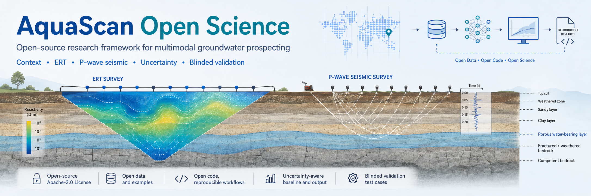

# AquaScan Open Science

<p align="center">
  
</p>

Open-source research framework for investigating whether **multimodal
hydrogeophysical measurements (ERT + P-wave seismic + GNSS RTK) combined with
documentary context** can improve groundwater prospecting — with explicit
uncertainty, blinding, and leakage-safe validation.

> **Status: research software.** AquaScan does **not** "detect groundwater" in
> v0.1. No real ERT/seismic groundwater validation has been performed.

## Why AquaScan

Groundwater is a critical resource. Borehole success rates depend on
geological judgement, and geophysical methods are often used without
quantified uncertainty. AquaScan is an attempt to build a **reproducible,
open, blinded** experimental framework to test whether geophysics adds
measurable predictive value beyond public documentary context.

## Scientific approach

```
Context (public hydrogeological records)
  + ERT + P-wave seismic + uncertainty
  + blinded validation (prediction freeze before Ground Truth reveal)
```

## Current status

- [x] IGME documentary ingestion / normalization / provenance (RAW immutable)
- [x] Ground Truth evidence methodology (independent targets, A/B/C/D quality)
- [x] Leakage-safe validation (grouped / spatial-block / cross-domain)
- [x] Open-source context baseline v2 (leakage-free, frozen)
- [x] GeoAI Context v0 (documentary context model)
- [x] ERT / seismic processing architecture (canonical schemas + pipelines)
- [ ] Physical hardware acceptance: **NOT YET PERFORMED** (no hardware acquired)
- [ ] Real groundwater validation with ERT/seismic: **NOT YET PERFORMED**
- [ ] Dry-well detection: **NOT VALIDATED**

Phrases like "detects groundwater", "finds water", or "proven system" describe
future objectives only, not current capability.

## Architecture

See [docs/architecture.md](docs/architecture.md).

## Ground Truth methodology

See [docs/methodology.md](docs/methodology.md) and
[docs/scientific-integrity.md](docs/scientific-integrity.md).

## Leakage-safe validation

- No naive random splits. Grouped folds, spatial-block holdout, and
  cross-domain holdout are enforced with tests.
- **Historical note:** the first baseline release contained target leakage
  and was marked invalid; see
  [docs/baseline-leakage-postmortem.md](docs/baseline-leakage-postmortem.md).
- All published results are the leakage-free Baseline v2 / forensic numbers;
  see [docs/current-results.md](docs/current-results.md).

## Open-source context baseline

Baseline v2 is the canonical comparator for future physical experiments.
See `reports/` (curated aggregate reports) and
[docs/current-results.md](docs/current-results.md).

## Physical processing stack

Canonical ERT/seismic observation schemas, deterministic pipelines,
handcrafted + grid encoders, cross-modal registration, and synthetic
engineering fixtures live in `src/aquascan/physical/`. It is tested on
**synthetic** data only; no real field performance is claimed.

## Field hardware

Phase 0 requires a geophysical field stack: a 48-electrode ERT system
(5 m spacing), a 24-channel P-wave seismic system (14 Hz geophones, 2 m
spacing), GNSS RTK positioning, an in-house calibration box (AutoCal), field
power (LiFePO4), and rugged compute/storage. **No hardware has been acquired
yet** — acceptance is not performed. See [docs/hardware.md](docs/hardware.md)
for the full bill of materials, specifications, and budget scenarios.

## What is NOT yet validated

- Real ERT/seismic groundwater accuracy (no field data)
- Dry-well discrimination (no confirmed negative Ground Truth)
- Physical hardware acceptance (not yet performed — no hardware acquired)
- Generalization to Región de los arenales (documented OOD failure)

## Reproducibility

```bash
python -m venv .venv && source .venv/bin/activate
pip install -e ".[dev]"
python -m pytest
python -m ruff check .
python -m ruff format --check .
```

Synthetic demonstrations (no data required):

```bash
python -c "from aquascan.physical.synthetic.fixtures import ErtHalfspaceFixture; print(ErtHalfspaceFixture(rho=250).forward().mean())"
```

The IGME downloader and enrichment scripts require network access and are
documented in `scripts/`; the core test suite uses fixtures/mocks and runs
offline.

## Project structure

```
src/aquascan/        # package: data, enrichment, ground_truth, evaluation,
                     #   baselines, features, physical (ert/seismic/fusion)
schemas/             # canonical JSON Schemas
protocols/           # public experimental protocols
examples/synthetic/  # clearly-labeled synthetic fixtures
docs/                # architecture, methodology, results, roadmap
reports/            # curated aggregate reports (no record-level data)
tests/               # public test suite (runs without private data)
```

## Data attribution

See [NOTICE_DATA.md](NOTICE_DATA.md). IGME is the source of original water-point
records; AquaScan is independent and not endorsed by IGME.

## Roadmap

See [docs/roadmap.md](docs/roadmap.md).

## Citation

See [CITATION.cff](CITATION.cff).

## License

Apache-2.0 (see [LICENSE](LICENSE)).
